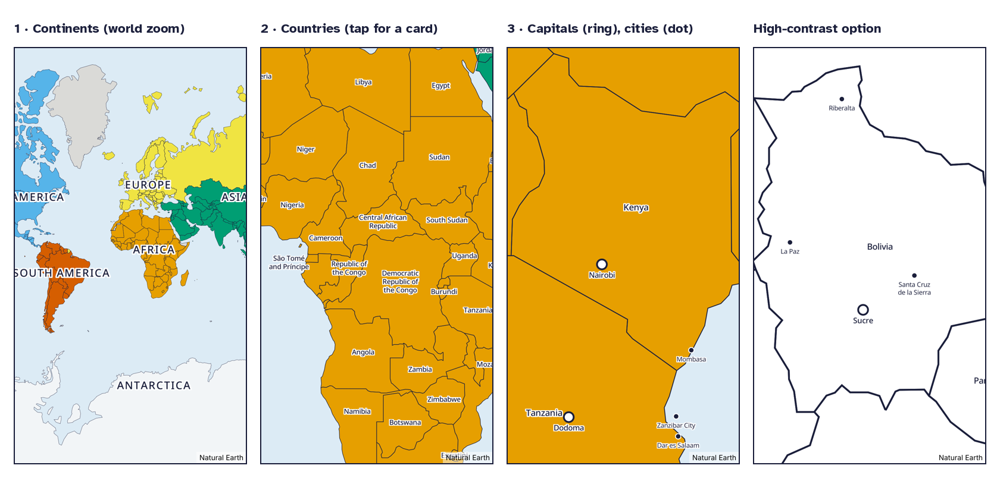
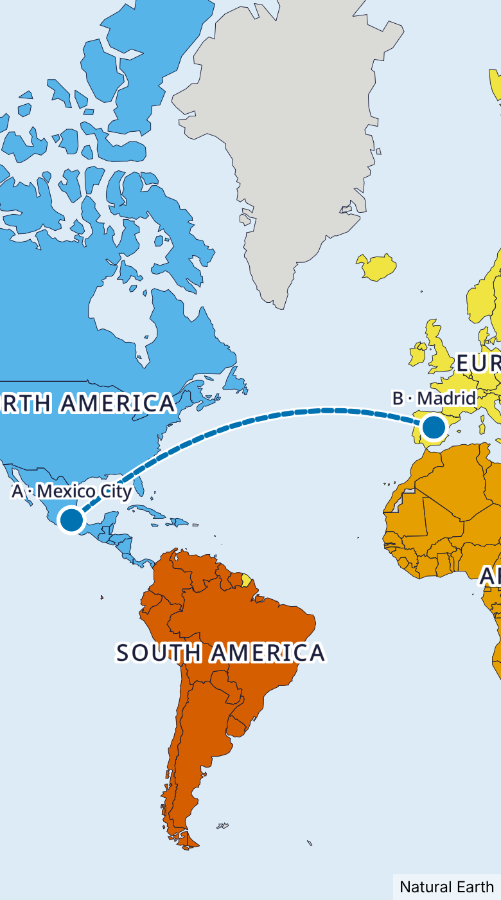

# World map (Step 3)



*These previews were rendered from the app's own map style with MapLibre GL JS, using `scripts/map-preview.ts`. The native app uses the same style with MapLibre Native.*

## What the player can do

| Zoom | Shows | Tap does |
|---|---|---|
| World (< 2.5) | 7 continents, each a different colour and labelled | Flies to that continent. Antarctica opens a fact card instead. |
| Continent / country (2.5–4) | Country borders and names | Opens the **country card** |
| Close (≥ 4) | Capitals (ring), then major cities (dot) from 4.75 | Opens the **capital / city card** |

**The card shows:**
- Flag, with alt text taken from the flag description
- Title and continent
- Photo slot (a placeholder until licensed photos arrive)
- Greeting, with a 🔊 button that says it in a native voice and then its meaning
- Capital, plus a note where the capital is shared or disputed
- Languages and currency
- Fun facts
- Read aloud and Stop buttons

**Spoken audio:** all speech uses the device's own text-to-speech (D6). If the device has no voice for the greeting's language, it reads the greeting with the student's voice and says so on screen.

**List view:** the same countries grouped by continent, searchable in English or Spanish and ignoring accents. It opens the same cards. It is the default when a screen reader is on.

## Measuring distance



- **📏 Measure** works on the map and in the list view.
  - **On the map:** tap two points. A tap snaps to a capital or city when one is under the finger. Otherwise it marks the exact spot ("A spot in Brazil" or "A spot in the ocean").
  - **Search:** both endpoints can be picked by name in English or Spanish, so the tool works with a screen reader.
  - **From a card:** "📏 Measure from here" starts from that place.
- **The path:** the map draws the shortest route over the globe, the way planes fly. Routes that cross the 180° line are split so both halves show.
- **The distance:** shown as the crow flies, in **both miles and kilometres**. The unit shown first follows the device setting, and the student can switch it.
- **The comparison:** *"That's like going from school to home and back about 2,816 times!"*
  - **Back and forth** means one round trip, which is twice the one-way distance.
  - **The count** uses exactly the distance shown, for example "about 1 mile".
  - **Rounding:** counts under 10 show one decimal, and larger counts are whole numbers.
- **Privacy:** the school-to-home distance is a rough value chosen from a short list (¼ mi to 10 mi, or 0.5 km to 20 km). The app never asks for an address and never uses GPS. The value is **device-only**: `syncablePreferences()` strips it before anything is saved to the server, and a test enforces this.

## Offline and privacy

- The whole-world map ships in the app: 232 KB of polygons, 71 KB of places and 740 KB of label glyphs. It works in airplane mode from first launch. **No map tiles are requested from any third party.**
- `Offline maps` (one pack per inhabited continent) installs the newest country content into a device-level SQLite cache. That cache holds published content only, never student data. A pack whose download is incomplete or off-contract is rejected.
- Detailed map tiles are designed in (`TileDownloader`, using MapLibre offline packs) but turned off until a self-hosted tile source exists. Set `EXPO_PUBLIC_DETAIL_STYLE_URL` to enable them.

## Accessibility

- **Colour:** continent colours are Okabe–Ito, and every continent is also labelled. Capitals and cities differ by shape and label weight, and the selected country gets a thick dashed outline. Colour is never the only signal.
- **High contrast:** the high-contrast map drops the fills and thickens the borders.
- **Text:** map label size follows the text-size preference. Card text follows the font preference (Atkinson Hyperlegible or OpenDyslexic).
- **Targets and motion:** buttons are at least 48 pt. Camera moves become instant when Reduce Motion is on.
- **Screen readers:** cards announce themselves and are modal. The download progress bar exposes its value.

## Regenerating map data

```bash
npm run content:build                       # countries + flags (the map needs them)
npm run map:build -- <natural-earth-dir>    # needs ne_50m_admin_0_countries + ne_10m_populated_places
npx tsx scripts/map-preview.ts <out-dir> [en|es] [--high-contrast] [--dark]
```
